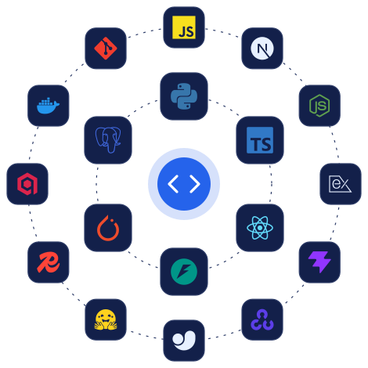
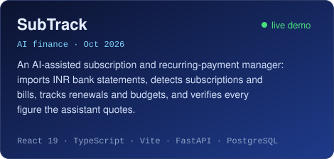

<!-- Generated file: do not edit README.md directly. Edit README.template and config.yml, then run scripts/build_readme.py. -->

<!--Banner-->

  

<!--Profile panel-->

<!--Header-->
# Hi, I'm Devendra! 👋
*AI/ML engineer in the making · full-stack builder*
 

<!--Intro-->

I build practical AI systems and the full-stack products around them — retrieval pipelines, digital twins and data tools that show their sources.

- 🎓 B.Tech CSE (AI & ML) at **KIIT**, Bhubaneswar — Class of 2028
- 🔋 Research internship at **NoonRay Energy Pvt. Ltd.** in battery electrochemistry ([AI Battery Fast Charging](https://github.com/devendrarajsingh07/AI_Battery_Fast_Charging))
- 🚀 Currently building **[SubTrack](https://github.com/devendrarajsingh07/AI-Powered-Subscription-Recurring-Payment-Manager)** — try the [live demo](https://ai-powered-subscription-recurring-p.vercel.app)
- 🏁 Smart India Hackathon 2026 build: **[MGHSIS](https://github.com/devendrarajsingh07/SIH2026-MGHSIS.)**
- ⚓ NCC Naval Wing cadet with a Grade B certificate
- 🤝 Open to internships, collaborations and ambitious product ideas
- 💻 Visit my [Portfolio](https://devendrarajsingh.netlify.app) for more about me

<!--Profile views-->

  

---

<!--Tech stack & latest builds-->
<h2 align="center">Tech stack & latest builds</h2>

<picture>
  <source media="(prefers-color-scheme: dark)" srcset="assets/stack_orbit_dark.svg">
  <source media="(prefers-color-scheme: light)" srcset="assets/stack_orbit_light.svg">
  
</picture>

<h3 align="left">Currently exploring</h3>
<ul align="left">
  <li>Retrieval-augmented generation and source-grounded answers</li>
  <li>Digital twins and predictive systems</li>
  <li>Computer vision for real-time safety analytics</li>
  <li>Responsible AI: verifiable, traceable outputs</li>
</ul>

<h3 align="left">Latest builds</h3>
<ul align="left">
  <li><a href="https://github.com/devendrarajsingh07/AI-Powered-Subscription-Recurring-Payment-Manager"><b>SubTrack</b></a> — AI finance · Oct 2026 · <a href="https://ai-powered-subscription-recurring-p.vercel.app">live demo</a></li>
  <li><a href="https://github.com/devendrarajsingh07/Pdf-with-Ai-Rag"><b>DocuMind</b></a> — RAG · Oct 2026</li>
  <li><a href="https://github.com/devendrarajsingh07/Traceable-impact-reporting-"><b>Traceable</b></a> — Data trust · Sep 2026</li>
  <li><a href="https://github.com/devendrarajsingh07/Human-Digital-Twin0.1"><b>Human Digital Twin</b></a> — Digital twin · Sep 2026</li>
  <li><a href="https://github.com/devendrarajsingh07/SIH2026-MGHSIS."><b>MGHSIS</b></a> — SIH 2026 · Aug 2026</li>
  <li><a href="https://github.com/devendrarajsingh07/billingpro-saas"><b>BillingPro SaaS</b></a> — SaaS · Aug 2026</li>
</ul>
 
 

<!--Stats table-->
<h2 align="center">📊 GitHub Stats 📊</h2>

<table width="100%">
  <tr>
    <td width="50%">
      <h3 align="center"><strong>GitHub Stats</strong></h3>
      

        
      

    </td>
    <td width="50%">
      <h3 align="center"><strong>Streak Stats</strong></h3>
      

        
      

    </td>
  </tr>
  <tr>
    <td width="50%">
      <h3 align="center"><strong>Latest Project</strong></h3>
      

        
      

    </td>
    <td width="50%">
      <h3 align="center"><strong>Languages</strong></h3>
      

        
      

    </td>
  </tr>
</table>
 

<!--Contribution graph-->
<h2 align="center">📈 Contribution Graph 📈</h2>

  

---

<!--Thought of the day (random quote per page load, no bot commits)-->
<h2 align="center">🌟 Thought of the Day 🌟</h2>

  

<!--Connect-->
<h2 align="center">🤝 Connect With Me 🤝</h2>

  &nbsp;
  &nbsp;
  &nbsp;
  

<!--Footer-->

  

