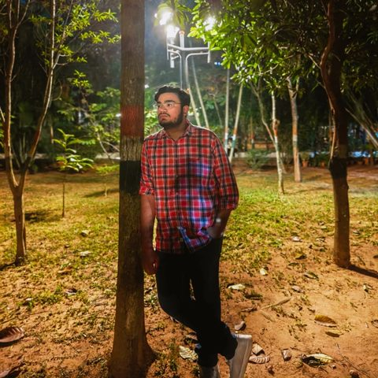

<!-- Generated file: do not edit README.md directly. Edit README.template and config.yml, then run scripts/build_readme.py. -->

  

  
  
  

  

<table align="center" border="0" cellpadding="0" cellspacing="0">
  <tr>
    <td valign="top" align="center">
      
    </td>
    <td width="24"></td>
    <td valign="top" align="center">
      
    </td>
  </tr>
</table>

## About me

I build practical AI systems and full-stack products where machine learning, real-time data, and thoughtful interfaces meet.

- 🎓 B.Tech CSE (AI & ML) at **KIIT**, Bhubaneswar — Class of 2028
- 🔋 Research internship at **NoonRay Energy Pvt. Ltd.** in battery electrochemistry (related: [AI Battery Fast Charging](https://github.com/devendrarajsingh07/AI_Battery_Fast_Charging))
- 🧠 Exploring **digital twins, computer vision, predictive systems, and responsible AI**
- 🛠️ Comfortable across the stack, from Python/FastAPI services to React/Next.js interfaces
- 🤝 Open to internships, collaborations, and ambitious product ideas
- ⚓ NCC Naval Wing cadet with a Grade B certificate

## Featured work

| Project | What it does | Stack |
|:--|:--|:--|
| **[SubTrack](https://github.com/devendrarajsingh07/AI-Powered-Subscription-Recurring-Payment-Manager)** [Live demo](https://ai-powered-subscription-recurring-p.vercel.app) | An AI-assisted subscription and recurring-payment manager: imports INR bank statements, detects subscriptions and bills, tracks renewals and budgets, and verifies every figure the assistant quotes. | `React 19 · TypeScript · Vite · FastAPI · PostgreSQL` |
| **[DocuMind](https://github.com/devendrarajsingh07/Pdf-with-Ai-Rag)** | A three-service PDF workspace with OCR and layout extraction, searchable chunks, and RAG answers grounded in source citations. | `Next.js 15 · Express · FastAPI · PostgreSQL · Qdrant · Redis` |
| **[Traceable](https://github.com/devendrarajsingh07/Traceable-impact-reporting-)** | Impact reporting for small nonprofits that merges messy program files, keeps fuzzy matches under human review, and traces every reported number to its source records. | `React · Vite · FastAPI · PostgreSQL · D3` |
| **[Human Digital Twin](https://github.com/devendrarajsingh07/Human-Digital-Twin0.1)** | A continuously learning student wellness twin with 3D visualization, forecasting, what-if simulation, and fidelity tracking. | `Next.js 15 · React 19 · FastAPI · Three.js · PostgreSQL` |
| **[MGHSIS](https://github.com/devendrarajsingh07/SIH2026-MGHSIS.)** | A local-first mass-gathering safety platform combining wearable telemetry, crowd analytics, risk prediction, and a venue digital twin. | `Next.js 16 · FastAPI · PostgreSQL · Redis · Python` |
| **[BillingPro SaaS](https://github.com/devendrarajsingh07/billingpro-saas)** | A multi-tenant billing and ERP platform with invoicing, inventory, payments, RBAC, subscriptions, and reporting. | `React 19 · Node.js · Express · SQLite · Docker` |

## GitHub activity

  

  <i>Build useful things. Learn in public. Keep improving.</i>

